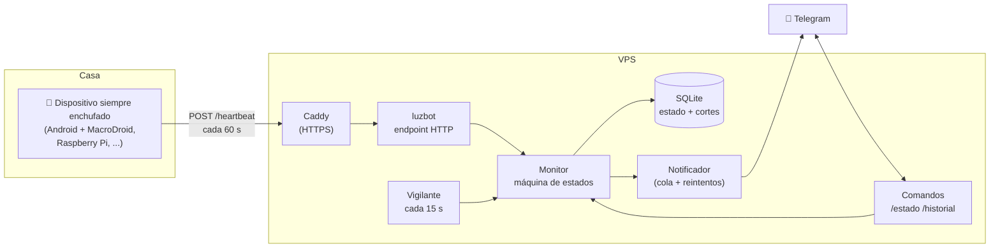

# luzbot ⚡

**Recibe un mensaje de Telegram cuando se va la luz en tu casa, y otro cuando vuelve, con cuánto duró el corte.**

🇬🇧 [Read in English](README.md)

```
🔴 Sin señal de casa
Último latido: 23/11 19:52
Posible corte de luz (o de internet).

🟢 Volvió la señal en casa
Hora: 23/11 21:10
Estuvo caída: 1 h 18 min (desde 23/11 19:52)
```

## Por qué

Los cortes de luz son frecuentes donde vivo y quería enterarme aunque no estuviera en casa. La primera idea fue que un servidor le hiciera "ping a mi Alexa" cada cierto tiempo, pero eso no funciona:

- Mi proveedor usa **CGNAT**: la IP WAN del router es privada (`10.x.x.x`) y la IPv4 pública se comparte con otros clientes, así que desde internet no se puede llegar a mi casa. El DNS dinámico tampoco sirve, porque apuntaría a la IP compartida del proveedor, que sigue encendida cuando mi casa se queda sin luz.
- El router sí tiene una **IPv6** pública, pero su firewall bloquea el ping entrante, y abrirlo implicaría exponer el router a internet.

Por eso luzbot funciona al revés, con un **latido** (*dead man's switch*). Un dispositivo en casa que está siempre enchufado (un Android viejo, una Raspberry Pi, un ESP32…) le avisa al servidor cada minuto. Cuando los avisos se detienen, el servidor da la alarma. Las conexiones salientes atraviesan cualquier NAT, firewall o cambio de IP, y no hay que abrir nada en casa.

## Cómo funciona



```
DESCONOCIDO --primer latido--> EN LÍNEA --sin latidos por TIMEOUT--> SIN SEÑAL
                                  ^                                       |
                                  +---------------- latido ---------------+
```

### Decisiones de diseño

- **Empujar, no consultar.** El CGNAT y los firewalls hacen la casa inalcanzable, pero el HTTPS saliente siempre funciona.
- **Solo librería estándar.** Nada que instalar, auditar ni actualizar en el servidor.
- **Las alertas no se pierden.** Pasan por una cola con reintentos y backoff exponencial. Si Telegram o la red del VPS fallan un momento, el aviso llega cuando se recuperan.
- **Resistente a reinicios.** El estado vive en SQLite: reiniciar en medio de un corte no duplica alertas ni pierde la hora de inicio. Tras un reinicio, espera un timeout completo antes de alertar, para no culpar a la casa por una caída del propio servidor.
- **Seguro por defecto.** HTTPS con Caddy, comparación del token en tiempo constante, tokens fuera de los logs, el bot solo responde a tu chat, y una unidad systemd endurecida.
- **Señal extra.** El teléfono puede reportar si está cargando. Si los latidos siguen llegando pero el teléfono dice que está desenchufado, probablemente el router está en una UPS (o alguien lo desenchufó), y te avisa.

## Instalación

Necesitas un servidor accesible desde internet (un VPS de 4–6 USD al mes sobra), una cuenta de Telegram y un dispositivo en casa siempre enchufado.

### 1. Crear el bot de Telegram

1. Habla con [@BotFather](https://t.me/BotFather), envía `/newbot` y guarda el **token**.
2. Escríbele cualquier mensaje a tu bot nuevo.
3. Abre `https://api.telegram.org/bot<TOKEN>/getUpdates` y copia el número de `"chat":{"id": ...}`: ese es tu **chat id**.

### 2. Instalar luzbot en el servidor (Ubuntu/Debian)

#### Despliegue con Dokploy (recomendado si ya lo tienes instalado)

1. Sube este repositorio a GitHub/GitLab y en Dokploy crea una aplicación desde ese repositorio.
2. Selecciona **Docker Compose** y el archivo `docker-compose.yml` de la raíz del proyecto.
3. En **Environment**, configura `TELEGRAM_TOKEN`, `TELEGRAM_CHAT_ID` y `HEARTBEAT_TOKEN`. Genera este último con `python3 -c 'import secrets; print(secrets.token_urlsafe(32))'`. El compose ya define `TIMEZONE=America/Caracas`, `LANGUAGE=es` y el timeout de 180 segundos; puedes cambiarlos allí.
4. Despliega la aplicación. El contenedor escucha en el puerto **8787** y guarda la base SQLite en el volumen persistente `luzbot_data` montado en `/data`.
5. En **Domains**, agrega un dominio o subdominio y apunta el proxy al servicio `luzbot`, puerto **8787**, con HTTPS habilitado. Dokploy/Caddy/Traefik debe reenviar `/heartbeat` al contenedor. No configures un segundo proxy Caddy dentro del VPS.
6. Comprueba que la aplicación esté saludable y envía un pulso de prueba:

```bash
curl -i -X POST -H "Authorization: Bearer <HEARTBEAT_TOKEN>" https://<tu-dominio>/heartbeat
# Debe responder HTTP 204
```

El token debe configurarse como variable de entorno en Dokploy; no lo guardes en el repositorio. Conserva el volumen `luzbot_data`: contiene el estado y el historial de cortes.

Para probarlo en tu PC antes de subirlo, copia `.env.example` a `.env`, reemplaza los tres valores obligatorios y ejecuta `docker compose up --build -d`. El servicio queda disponible solo desde tu PC en `http://127.0.0.1:8787`; `.env` está excluido de Git. Para detenerlo usa `docker compose down` (el volumen de datos se conserva).

#### Instalación manual con systemd

```bash
sudo git clone https://github.com/OWNER/luzbot.git /opt/luzbot

sudo mkdir -p /etc/luzbot
sudo cp /opt/luzbot/deploy/luzbot.env.example /etc/luzbot/luzbot.env
sudo chmod 600 /etc/luzbot/luzbot.env
python3 -c 'import secrets; print(secrets.token_urlsafe(32))'   # -> HEARTBEAT_TOKEN
sudo nano /etc/luzbot/luzbot.env                                 # llena los valores

sudo cp /opt/luzbot/deploy/luzbot.service /etc/systemd/system/
sudo systemctl daemon-reload
sudo systemctl enable --now luzbot
journalctl -u luzbot -f
```

### 3. HTTPS con Caddy

Instala Caddy siguiendo las [instrucciones oficiales](https://caddyserver.com/docs/install#debian-ubuntu-raspbian) y luego:

```bash
sudo cp /opt/luzbot/deploy/Caddyfile /etc/caddy/Caddyfile
sudo nano /etc/caddy/Caddyfile        # pon tu hostname, por ejemplo 203-0-113-10.sslip.io
sudo systemctl reload caddy

sudo ufw allow OpenSSH && sudo ufw allow 80,443/tcp && sudo ufw enable
```

¿No tienes dominio? [sslip.io](https://sslip.io) convierte `203-0-113-10.sslip.io` en `203.0.113.10`, y con eso Caddy obtiene el certificado.

Pruébalo desde cualquier lugar:

```bash
curl -i -X POST -H "Authorization: Bearer $HEARTBEAT_TOKEN" https://203-0-113-10.sslip.io/heartbeat
# HTTP/2 204  -> y Telegram dice "Monitoreo activo"
```

### 4. Configurar el dispositivo de casa

**Teléfono Android (no necesita SIM, usa el WiFi de la casa)** con [MacroDroid](https://www.macrodroid.com/):

1. Crea una macro nueva.
2. **Disparador:** *Fecha/Hora → Intervalo regular* → cada **1 minuto**.
3. **Acción:** *Conectividad → Petición HTTP*:
   - Método: **POST**
   - URL: `https://<tu-host>/heartbeat`
   - Cabecera: `Authorization` = `Bearer <HEARTBEAT_TOKEN>`
   - Parámetro opcional: `charging` = el texto mágico de "corriente conectada" o "cargando" de MacroDroid. Sirve cualquier valor del tipo `true/false`, `on/off` o `1/0`.
4. Guarda la macro.

En los ajustes del teléfono:
- Batería de MacroDroid en **sin restricciones**.
- Permitir que MacroDroid se inicie al encender el teléfono.
- WiFi siempre activo durante la suspensión.
- Si el teléfono lo permite, activa un límite de carga (por ejemplo 80%) para cuidar una batería que pasa todo el tiempo enchufada.

**Linux (Raspberry Pi, servidor casero):** usa [`clients/heartbeat.sh`](clients/heartbeat.sh) con cron:

```cron
* * * * * LUZBOT_URL=https://203-0-113-10.sslip.io LUZBOT_TOKEN=... /opt/luzbot/clients/heartbeat.sh
```

### 5. Probarlo

Apaga el WiFi del dispositivo de casa: a los 3 minutos más o menos te llega 🔴. Vuelve a encenderlo y te llega 🟢 con la duración.

## Comandos del bot

- `/estado`: estado actual y resumen de los últimos 30 días
- `/historial`: los últimos 10 cortes
- `/armar` / `/desarmar`: activar o silenciar las alertas de cortes. Los pulsos siguen llegando mientras está desarmado; el estado se conserva al reiniciar.
- `/ayuda`: lista de comandos

## Configuración

Todas las variables están explicadas en [`deploy/luzbot.env.example`](deploy/luzbot.env.example) y en la tabla del [README en inglés](README.md#configuration).

## Limitaciones

- Desde afuera, un corte de luz y una caída de internet se ven igual. Si el router está en una UPS, el aviso llega cuando se acaba la batería (y el aviso de "no está cargando" te dice antes que el teléfono se quedó sin corriente).
- La hora de inicio del corte es la del último latido recibido, con precisión de aproximadamente un minuto.

## Desarrollo

```bash
python3 -m venv .venv && . .venv/bin/activate
pip install -e ".[dev]"
pytest -q
ruff check . && ruff format --check .
```

## Licencia

[MIT](LICENSE)
