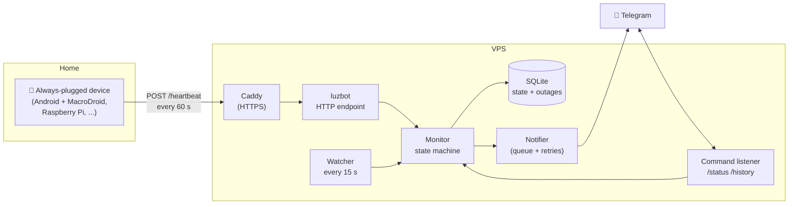

# luzbot ⚡

**Get a Telegram message when the power goes out at home, and another one when it comes back, with how long it lasted.**

[](https://github.com/OWNER/luzbot/actions/workflows/ci.yml)


🇪🇸 [Leer en español](README.es.md)

```
🔴 No signal from home
Last heartbeat: 23/11 19:52
Possible power (or internet) outage.

🟢 Home is back online
Time: 23/11 21:10
Outage lasted: 1 h 18 min (since 23/11 19:52)
```

## Why

Power cuts are frequent where I live, and I wanted to know about them while away from home. My first idea was to have a server "ping my Alexa" every few minutes. That doesn't work:

- My ISP uses **CGNAT**: the router's WAN address is private (`10.x.x.x`) and the public IPv4 is shared with other customers, so nothing on the internet can reach my home. Dynamic DNS doesn't help, because it would point at the ISP's shared address, which stays up when my house goes dark.
- The router does have a public **IPv6** address, but its firewall drops inbound ICMP, and opening it would mean exposing the router to the internet.

So luzbot flips the direction: a **heartbeat** (a _dead man's switch_). A device at home that is always plugged in (an old Android phone, a Raspberry Pi, an ESP32...) calls the server every minute. When the calls stop, the server raises the alarm. Outbound connections work through any NAT, firewall or IP change, and nothing at home has to be opened.

## How it works



The monitor is a small state machine persisted in SQLite:

```
UNKNOWN --first heartbeat--> ONLINE --no heartbeat for TIMEOUT--> OFFLINE
                               ^                                     |
                               +-------------- heartbeat ------------+
```

### Design decisions

- **Push, not pull.** CGNAT and firewalls make the home unreachable; outbound HTTPS always works.
- **Standard library only.** No dependencies to install, audit or update on the server: `http.server`, `sqlite3`, `urllib`, `zoneinfo`.
- **Alerts are never lost.** Messages go through a queue with exponential backoff. If Telegram or the VPS network hiccups, the alert is delivered once it recovers, and the monitor never blocks on the network.
- **Restart-safe.** State lives in SQLite, so a restart in the middle of an outage doesn't send duplicate alerts or lose the start time. After a restart, the watcher waits a full timeout before alerting, so downtime of the server isn't blamed on the house.
- **Secure by default.** HTTPS through Caddy, constant-time token comparison, tokens kept out of logs, the bot only answers your chat id, and a hardened systemd unit (`DynamicUser`, `ProtectSystem=strict`...).
- **Bonus signal.** A phone can report whether it is charging. If heartbeats keep arriving but the phone says it's unplugged, the router is probably on a UPS (or someone unplugged the phone), and you get a warning.

## Features

- 🔴/🟢 Alerts on outage and recovery, with duration
- `/status` (`/estado`): current state plus a 30-day summary
- `/history` (`/historial`): the 10 most recent outages
- Messages in Spanish or English, times in your timezone
- Works with any client that can make an HTTP request

## Setup

You need a server reachable from the internet (a $4–6/month VPS is plenty), a Telegram account and a device at home that is always plugged in.

### 1. Create the Telegram bot

1. Talk to [@BotFather](https://t.me/BotFather), send `/newbot` and save the **token**.
2. Send any message to your new bot.
3. Open `https://api.telegram.org/bot<TOKEN>/getUpdates` and copy `"chat":{"id": ...}`: that is your **chat id**.

### 2. Install luzbot on the server (Ubuntu/Debian)

#### Deploy with Dokploy (recommended if it is already installed)

1. Push this repository to GitHub/GitLab and create an application from it in Dokploy.
2. Select **Docker Compose** and use the root `docker-compose.yml` file.
3. In **Environment**, set `TELEGRAM_TOKEN`, `TELEGRAM_CHAT_ID` and `HEARTBEAT_TOKEN`. Generate the last one with `python3 -c 'import secrets; print(secrets.token_urlsafe(32))'`. The compose file defaults to `TIMEZONE=America/Caracas`, `LANGUAGE=es` and a 180-second timeout; you can change these there.
4. Deploy the application. The container listens on port **8787** and stores SQLite in the persistent `luzbot_data` volume mounted at `/data`.
5. Under **Domains**, add a domain or subdomain and point the proxy to service `luzbot`, port **8787**, with HTTPS enabled. Dokploy's proxy should forward `/heartbeat` to the container. Do not configure a second Caddy proxy on the VPS.
6. Check that the application is healthy, then send a test heartbeat:

```bash
curl -i -X POST -H "Authorization: Bearer <HEARTBEAT_TOKEN>" https://<your-domain>/heartbeat
# Should return HTTP 204
```

Set the token as an environment variable in Dokploy; do not store it in the repository. Keep the `luzbot_data` volume because it contains the monitor state and outage history.

To test locally first, copy `.env.example` to `.env`, replace the three required values, and run `docker compose up --build -d`. The service is available only on your PC at `http://127.0.0.1:8787`; `.env` is excluded from Git. Stop it with `docker compose down` (the data volume is preserved).

#### Manual systemd installation

```bash
sudo git clone https://github.com/OWNER/luzbot.git /opt/luzbot

sudo mkdir -p /etc/luzbot
sudo cp /opt/luzbot/deploy/luzbot.env.example /etc/luzbot/luzbot.env
sudo chmod 600 /etc/luzbot/luzbot.env
python3 -c 'import secrets; print(secrets.token_urlsafe(32))'   # -> HEARTBEAT_TOKEN
sudo nano /etc/luzbot/luzbot.env                                 # fill in the values

sudo cp /opt/luzbot/deploy/luzbot.service /etc/systemd/system/
sudo systemctl daemon-reload
sudo systemctl enable --now luzbot
journalctl -u luzbot -f
```

### 3. HTTPS with Caddy

Follow the [official install instructions](https://caddyserver.com/docs/install#debian-ubuntu-raspbian), then:

```bash
sudo cp /opt/luzbot/deploy/Caddyfile /etc/caddy/Caddyfile
sudo nano /etc/caddy/Caddyfile        # set your hostname, e.g. 203-0-113-10.sslip.io
sudo systemctl reload caddy

sudo ufw allow OpenSSH && sudo ufw allow 80,443/tcp && sudo ufw enable
```

No domain? [sslip.io](https://sslip.io) maps `203-0-113-10.sslip.io` to `203.0.113.10`, which is enough for Caddy to get a certificate.

Test it from anywhere:

```bash
curl -i -X POST -H "Authorization: Bearer $HEARTBEAT_TOKEN" https://203-0-113-10.sslip.io/heartbeat
# HTTP/2 204  -> and Telegram says "Monitoring active"
```

### 4. Set up the home device

**Android phone (no SIM needed, it uses the home WiFi)** with [MacroDroid](https://www.macrodroid.com/):

|                            |                                                           |
| -------------------------- | --------------------------------------------------------- |
| Trigger                    | _Regular interval_ → every **1 minute**                   |
| Action                     | _HTTP request_ → **POST** `https://<your-host>/heartbeat` |
| Header                     | `Authorization: Bearer <HEARTBEAT_TOKEN>`                 |
| Query parameter (optional) | `charging` = MacroDroid's _power connected_ magic text    |

Then, on the phone: set MacroDroid's battery usage to **unrestricted**, allow it to start at boot, and keep WiFi on during sleep. If the phone supports it, enable a charge limit (e.g. 80%) to protect a battery that is always plugged in.

**Linux box (Raspberry Pi, home server):** use [`clients/heartbeat.sh`](clients/heartbeat.sh) from cron:

```cron
* * * * * LUZBOT_URL=https://203-0-113-10.sslip.io LUZBOT_TOKEN=... /opt/luzbot/clients/heartbeat.sh
```

### 5. Try it

Turn off WiFi on the home device: after about 3 minutes you get 🔴. Turn it back on and you get 🟢 with the duration.

## API

| Method       | Path         | Auth                                                             | Response                         |
| ------------ | ------------ | ---------------------------------------------------------------- | -------------------------------- |
| `POST`/`GET` | `/heartbeat` | `Authorization: Bearer <token>`, `X-Token: <token>` or `?token=` | `204`, or `401` with a bad token |
| `GET`        | `/healthz`   | none (localhost only, not proxied)                               | `200 ok`                         |

Optional field `charging` (`true`/`false`/`on`/`off`/`1`/`0`...) in the query string, a form body or a JSON body.

## Configuration

| Variable                      | Default              | Description                                               |
| ----------------------------- | -------------------- | --------------------------------------------------------- |
| `TELEGRAM_TOKEN`              | _required_           | Bot token from @BotFather                                 |
| `TELEGRAM_CHAT_ID`            | _required_           | The only chat that receives alerts and can run commands   |
| `HEARTBEAT_TOKEN`             | _required_           | Shared secret, at least 24 characters                     |
| `TIMEOUT_SECONDS`             | `180`                | Silence before declaring an outage (min 60)               |
| `CHECK_INTERVAL_SECONDS`      | `15`                 | How often the watcher checks                              |
| `TIMEZONE`                    | `UTC`                | IANA timezone for displayed times, e.g. `America/Caracas` |
| `LANGUAGE`                    | `es`                 | `es` or `en`                                              |
| `LISTEN_HOST` / `LISTEN_PORT` | `127.0.0.1` / `8787` | Where the HTTP endpoint listens                           |
| `DB_PATH`                     | `luzbot.db`          | SQLite file                                               |
| `LOG_LEVEL`                   | `INFO`               | Python logging level                                      |

## Limitations

- From the outside, a power cut and an internet outage look the same. If the router is on a UPS, you're alerted when the UPS runs out (and the `charging` warning tells you the phone lost power earlier).
- Outage start times are the last heartbeat received, so they are accurate to about a minute.

## Development

```bash
python3 -m venv .venv && . .venv/bin/activate
pip install -e ".[dev]"
pytest -q
ruff check . && ruff format --check .
```

Tests use a fake clock, an in-memory database and a real HTTP server on a random port.

## Roadmap

- [ ] ESP32 client (Arduino sketch)
- [ ] Monitor several homes or devices
- [ ] Weekly outage summary
- [ ] Secondary watchdog that alerts if the VPS itself goes down (e.g. healthchecks.io)

## License

[MIT](LICENSE)
